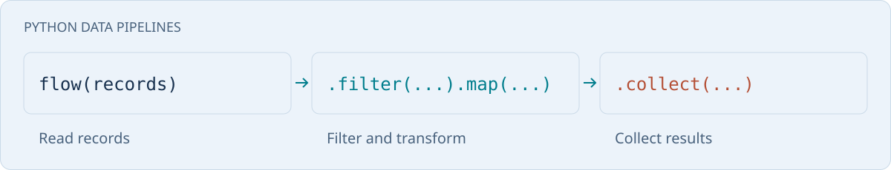

<a href="https://steventimes.github.io/">
  <picture>
    <source media="(prefers-color-scheme: dark) and (max-width: 600px)" srcset="assets/hero-dark-compact.svg">
    <source media="(prefers-color-scheme: light) and (max-width: 600px)" srcset="assets/hero-light-compact.svg">
    <source media="(prefers-color-scheme: dark)" srcset="assets/hero-dark.svg">
    
  </picture>
</a>

I'm **Hongchen (Steven) Yang**, a computer science student at **Brandeis University**.
My work spans adaptive storage systems and developer tools for Python data
processing, notebook editing, and AI agent workflows.

[Website](https://steventimes.github.io/) · [Research](https://steventimes.github.io/#research) · [LinkedIn](https://www.linkedin.com/in/hongchen-yang-3803b4294/) · [Gmail](mailto:stevenyang0316@gmail.com)

## Selected work

### [fpstreams](https://github.com/steventimes/fpstreams)

<a href="https://steventimes.github.io/fpstreams/playground/">
  <picture>
    <source media="(prefers-color-scheme: dark) and (max-width: 600px)" srcset="assets/pipelines-dark-compact.svg">
    <source media="(prefers-color-scheme: light) and (max-width: 600px)" srcset="assets/pipelines-light-compact.svg">
    <source media="(prefers-color-scheme: dark)" srcset="assets/pipelines-dark.svg">
    
  </picture>
</a>

**Build lazy data pipelines in Python.** Filter and transform iterables and
records, limit concurrent async work, and aggregate key/value data. Supported
operations can use native execution paths.

A pinned fpstreams source snapshot is
[listed in the XERJ Corpus Hub](https://hub.xerj.org/corpus/steventimes--fpstreams).
The entry provides instructions for local indexing.

**Python · Rust** · [Try the playground](https://steventimes.github.io/fpstreams/playground/) · [Read the docs](https://steventimes.github.io/fpstreams/) · [Install from PyPI](https://pypi.org/project/fpstreams/)

### [Jupyter Notebook Git Marks](https://github.com/steventimes/git-for-jupyterNotebook)

**See what changed without leaving your notebook.** Git marks inside
VS Code's native notebook editor identify added, modified, and deleted lines,
including edits you haven't saved yet.

**TypeScript · VS Code** · [Get the extension](https://marketplace.visualstudio.com/items?itemName=StevenYang0316-5274.notebook-git-gutter) · [View source](https://github.com/steventimes/git-for-jupyterNotebook)

### [Dependency Checker](https://github.com/steventimes/dependency-checker)

**Trace dependencies from declarations to source usage.** Inspect declared
packages, locked versions, and usage evidence through a CLI, MCP server, or agent
skill. Scans parse repository files without running the target project's code.

**Python · MCP** · [Set up for a coding agent](https://github.com/steventimes/dependency-checker#use-with-a-coding-agent) · [View source](https://github.com/steventimes/dependency-checker)

### [Soccer Analytics](https://github.com/steventimes/soccer-analytics)

**Explore football data and compare models on historical holdouts.** Research covers
matches, teams, and players, with reproducible examples that keep training and
evaluation periods separate. These examples do not establish readiness for
prospective prediction.

**Python · Machine learning** · [Explore research results](https://github.com/steventimes/soccer-analytics/blob/main/results/README.md) · [Reproduce examples](https://github.com/steventimes/soccer-analytics/blob/main/REPRODUCING.md)

## Storage systems research

My research focuses on **FluidLSM and RocksDB tuning for changing workloads**.
I use controlled benchmarks to study how access patterns affect compaction and
performance in LSM trees, and to evaluate adaptive tuning methods.

[Explore my research](https://steventimes.github.io/#research) · [All repositories](https://github.com/steventimes?tab=repositories) · [Get in touch](mailto:stevenyang0316@gmail.com)
